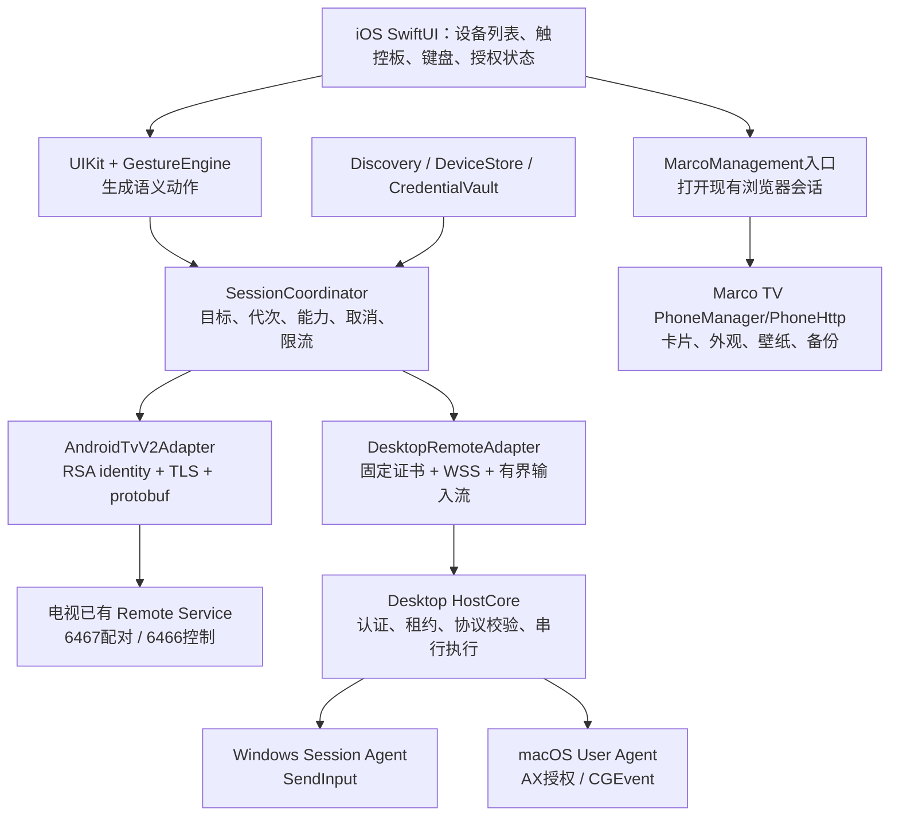
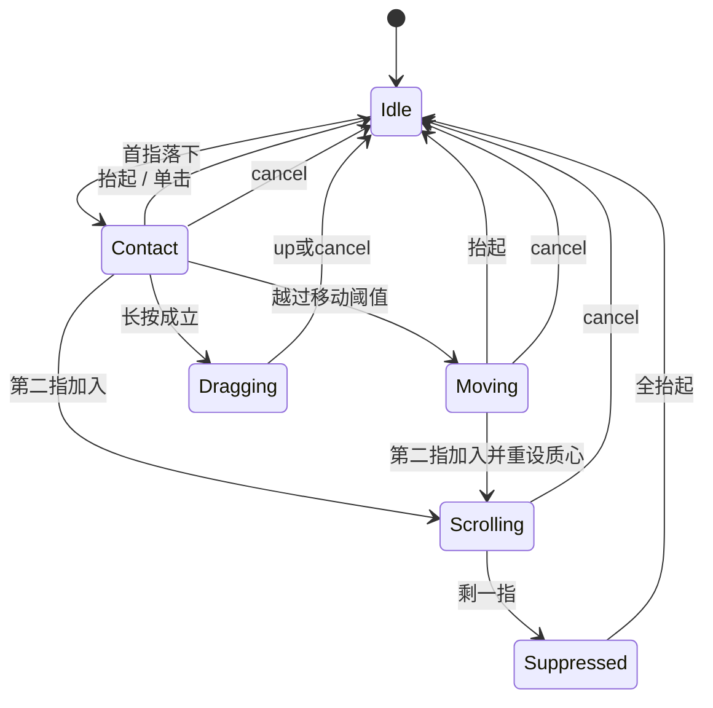

# Marco Remote 可落地架构

日期：2026-11-05。状态：**待实现的设计方案**。基线为 Marco TV 0.15.0 / `a9d6cb8b64fd2e9030c82addd22edc40a5e755c0`。研究证据、固定仓库提交、许可证及本次测试见 [REMOTE_RESEARCH.md](REMOTE_RESEARCH.md)。本文件不表示已经增加这些功能；本次只新增这两份文档。

## 1. 产品边界与架构决策

一期交付方向：iPhone 控制兼容 Android TV 的方向键、返回、主页及基础文本；控制 Windows/macOS 的真正相对鼠标、点击、拖拽、滚动及显式文本提交；可打开现有 Marco TV 浏览器管理页面。多设备可以保存和切换，手机同时只拥有一个活动输入目标。

| 决策 | 方案（P） | 来源与理由 |
|---|---|---|
| A01 三类协议适配 | AndroidTvV2、DesktopRemote、MarcoManagement 分开；上层统一设备/能力模型 | [V1][V4] v2是protobuf；[S6] 桌面WSS；[M1][M2] 管理HTTP，权限/会话不同 |
| A02 iOS原生触面 | SwiftUI外壳 + UIKit触摸采集 + 纯状态机；网络由独立串行执行域拥有 | [S1][S2][S3][P3]，避免识别/动画/网络互相阻塞 |
| A03 先WSS | 自有电脑协议用TLS上持久WebSocket、小帧、严格有界队列；不在一期自制UDP加密协议 | [S6][S10]有现成结构参考；[P1]裸UDP缺认证/防重放 |
| A04 新控制链不依赖PhoneHttp | 旧管理入口继续使用；先不抽取/重构稳定版 | [M1]每请求关闭/落盘，[M2]Activity绑定、单手机短会话 |
| A05 真鼠标只在支持后端声明 | v2为focus导航；TV无障碍可选节点光标；电脑为系统pointer | [A1][S7][S8][O1]，防止把焦点导航伪装成鼠标 |
| A06 单设备单控制者 | 自有接收端支持多条可信设备记录，但只有一个输入租约；切换必须结束旧手势 | [S6]单控制槽、[S3]drag尾部、[K1][K3]信任与连接分离 |
| A07 不扩稳定版权限 | 不修改HomeKeyService或TaskBridgeServer；ADB/无障碍扩展放到独立后续里程碑 | [M4]没有节点读取/发手势；[M6]shell bridge与普通应用身份不同 |
| A08 许可隔离 | TV端复用继续GPL-3.0-only；iOS/独立receiver先原创，候选依赖逐文件准入 | [L1]–[L5][K8][O6]；androidremote原创代码暂无复用授权 |

一期明确不包含：云中继、互联网端口映射、锁屏解锁、管理员桌面控制、任意shell、屏幕镜像、远程文件浏览、剪贴板常驻同步、语音音频流、全品牌电视鼠标。这是范围取舍，不是对未来功能的否定。

## 2. 系统结构



图为P，依据上文A01–A08决策。方向键/文本/桌面输入不经过稳定版PhoneHttp。后续如做Marco TV原生管理或受限遥控，另建可选安全端点；不把图中的管理HTTP伪装成新加密协议。

### 2.1 技术栈与模块责任

| 模块 | 拟定技术与所有权 | 对外契约 | 不承担的责任 |
|---|---|---|---|
| iOS AppShell | SwiftUI；视图主线程 | 设备列表、输入模式、权限/连接状态 | 不持有socket、不拼protobuf |
| GestureEngine | 原创Swift纯逻辑；UIKit适配 | 输入接触点/时间，输出PointerDelta/Scroll/Click/Drag/Navigation | 不读取网络/Keychain |
| SessionCoordinator | Swift actor/串行状态机 | 单target、generation、capabilities、取消/重连 | 不把网络连接成功等同可输入 |
| Discovery | NWBrowser + 手动地址/扫码 | Candidate列表及endpoint更新 | 不决定信任、不静默配对 |
| CredentialVault | iOS Keychain | 每peer credential、pin、删除 | 不存UserDefaults/日志/二维码历史 |
| AndroidTvV2 | Swift协议模块 + 经审核的protobuf生成工具 | Polo配对、feature、按键、IME、ping | 不实现Google服务端、不依赖Python运行时 |
| Desktop HostCore | C#/.NET 10 + Kestrel，协议/会话核心跨平台 | HTTPS配对与WSS控制、校验、租约 | 不直接把所有消息转成OS事件 |
| WindowsInput | C# P/Invoke，交互用户进程 | SendInput、权限/会话状态、ReleaseOwned | 不运行在Session 0执行输入 |
| MacInput | C#到公开Quartz/AX API；原生菜单栏薄壳 | CGEvent、TCC状态、ReleaseOwned | 不使用私有CGS、不自动批准TCC |
| TV Domain Adapter（后续） | MarcoTV内部Java/GPL模块 | typed管理命令、revision、主线程调度 | 不授予shell、不开放任意Intent |

选择共享.NET桌面核心而不是全量Qt/KDE或Rust跨语言核心，是降低一期协议/会话双份实现的工程取舍；Sofatap提供此结构的源码先例，但不直接整仓复制。[S6][S14][S15][K5] 本机仅SDK8，**实施前需准备隔离的.NET10工具链**。Apple侧必须有Mac/Xcode/iPhone验证环境；本次未建立。

目标测试基线暂定 iOS 17+、Windows 11 x64、macOS 14+ Apple Silicon，Windows ARM64/macOS Intel后补；这是测试范围建议，不是已验证最低系统要求。立项时以所选SDK支持矩阵复核，再固定版本。TV先测现有Android 9设备及一台带Remote Service的较新Google TV，不能把旧机测试外推至全部机型。

### 2.2 设备与能力模型

拟定内部模型：

```text
DeviceRecord
  localId: UUID
  displayName, userAlias, kind: tv | computer | marcoTv
  endpoints[]: address + port + interfaceScope + lastSeen
  services[]: androidTvV2 | desktopV1 | marcoManagementLegacy
  trustRef: Keychain/OS vault引用（不放密钥内容）
  trustState: unknown | pending | paired | revoked | identityChanged
  capabilitySnapshot + capabilityRevision + lastVerifiedAt
```

IP、服务名、型号都不是设备identity。自有receiver使用随机deviceId与配对证书绑定；v2在配对后绑定电视证书及客户端identity。未知阶段只按service endpoint临时去重；确认信任后按认证identity合并。不能因同IP、同名或同MAC把Marco管理入口与Google服务自动合并；必要时由用户确认关联。这是[K1][K2][S4]身份原则的P设计。

每个能力都携带状态和作用域，不能只有一个 `supportsMouse`：

| 能力 | 取值示例 | 默认 |
|---|---|---|
| navigation | dpad、back、home、media；含各命令可用性 | 未协商false |
| pointer | none / desktopRelative / accessibilityNodeCursor；scope=ownApp/system | TV v2=none |
| buttons | left/right/drag分别声明 | 节点光标不宣称right/drag |
| text | commit / imeContext / unsupported；maxUtf8Bytes、focusRevision | 未确认输入上下文则禁用 |
| management | cards/appearance/backup/diagnostics | 仅对应管理端点 |
| availability | ready / permissionRequired / locked / busy / unsupported / offline | 不由TLS成功推导ready |
| resultMeaning | transportSent / receiverAccepted / osSubmitted / frameworkAccepted | 不出现“UI操作成功”泛化 |

能力下降即时禁用对应UI并取消手势；未知扩展忽略，未知输入命令拒绝。电视品牌仅显示，不驱动权限推断。[S7][V4][O4]

## 3. 发现、配对、密钥与多设备会话

### 3.1 发现

P：自有receiver发布 `_marco-remote._tcp`，TXT只放协议主版本、kind和非秘密deviceId。v2浏览 `_androidtvremote2._tcp`。管理旧HTTP没有现成服务发现，仍由电视显示地址/扫码，不承诺“自动找到所有Marco TV”。[A2][M2]

设备列表区分“已保存但离线”“附近未配对”“身份变化”。重新发现可以更新地址，不能替换pin。支持IPv4、IPv6及link-local scope；绑定特定接口，排除非授权公网/VPN路由；发现丢失不立即删除凭据。mDNS受AP隔离/网络拓扑影响，手工输入地址仍走同一认证流程，不能退回明文。[A2][K1][S11]

iOS在前台说明本地网络用途，声明 `NSLocalNetworkUsageDescription` 和所浏览的 `NSBonjourServices`；相机权限只在扫码时请求。不把拒绝网络权限误显示成“没有电视”。macOS也考虑本地网络隐私设置；使用Bonjour，暂不采用原始UDP广播作为iOS发现方案。[O8] Android后续接收端按实际target适配当前本地网络权限。[O3]

### 3.2 自有receiver的配对：QR固定证书 + 单次票据

本节全为P，以[S4][S5][S6]为参考，但修正共享长期token不便独立撤销的问题。密码学交给平台TLS与随机数API，不自创密钥交换。

1. receiver第一次启用时生成持久TLS证书/私钥与随机deviceId，保存在用户私有存储；默认关闭配对窗口。TLS最低1.2，支持时优先1.3，不启用0-RTT输入。证书生成/更新均记录非秘密版本。
2. 用户在接收端选择“添加手机”，生成256-bit一次性随机票据，120秒有效；内存只留其摘要。二维码含协议版本、deviceId、候选地址/端口、DER leaf SHA-256完整指纹、票据。二维码不含长期控制凭据；窗口关闭立即作废。
3. 手机扫描后先检查URI长度、字段白名单、端口/地址类型，建立HTTPS连接。**传出票据前完成完整指纹固定校验**，并校验证书签名、有效期和本协议绑定的身份；自签名不走“信任所有”回调。平台验签/策略不一致即失败。
4. `/v1/pair` 在固定证书TLS内提交票据、随机clientId、手机显示名；校验一次性/期限/全局及来源速率限制。同一配对窗口只允许一个pending，receiver显示请求详情并要求本机确认；拒绝或超时不发凭据。
5. 用户批准后原子消耗票据，为该clientId签发独立256-bit随机credential，仅通过当前TLS响应给手机。主机保存credential摘要/授权范围/名称/createdAt/revokedAt，手机存Keychain。并发扫码只有一个可完成。
6. 手机持久化成功后才显示“已配对”；响应丢失不自动重复签发，超时重新开窗口。接收端可清理未确认的孤立授权记录，不能把pair请求自动执行为输入。

证书pin视为配对信任根，IP仅是拨号位置；地址迁移必须仍匹配完整pin。TLS验证应明确分为固定pin策略与公共Web PKI策略，不设置全局ATS例外、不得将某个“接受任意证书”的callback复用于其他服务。iOS具体URLSession/Security策略、IP变更与证书SAN匹配必须通过G1测试后固定；没有通过之前不宣称可透明换网。[S4]

手动配对的一期兜底为接收端显示完整配对URI/可复制长代码，含同样指纹与高熵票据。**不把六位短PIN作为bearer token，也不先用未认证TLS提交秘密。** 若后续要短码，使用经审查的PAKE实现并加独立安全验证，不在一期另造算法。v2电视六码是不同协议，不复用这里的票据格式。[V2]

### 3.3 重连、撤销、存储

| 事件 | 自有receiver行为（P） |
|---|---|
| 正常重连 | 先校验pin，再携该手机credential；认证后重新协商能力/新sessionId；不恢复未确认输入 |
| 删除单手机 | 标记对应credential撤销，主动关闭其连接和租约，释放其输入；其他手机不必重配 |
| 手机点“忘记” | 在线先请求撤销，随后删Keychain；离线只删除本地，并明确接收端记录仍需本机撤销 |
| 证书轮换/系统重装 | 标为identityChanged，要求重新扫码；不因IP/名字相同静默信任新证书 |
| 修改地址 | 仅更新路由，pin与设备授权保持原值；地址到达不同证书则停止 |
| 配对端暴力请求 | 窗口关闭直接拒绝；单窗口最多5次失败后关闭，另设全局/IP速率和未认证连接上限 |
| 接收端暂停/退出/锁屏 | 停止输入、回收租约、ReleaseOwned；锁屏后不自动恢复拖拽 |

手机Keychain采用ThisDeviceOnly/解锁可读。Windows credential/private key用用户级DPAPI和ACL；macOS用Keychain；Android后续用Keystore保护本机私钥。pair URI、token、Authorization、文本内容、按键序列不进日志/崩溃遥测；备份默认排除凭据。[S4][S5] 这些是设计要求，未实现。

### 3.4 Android TV v2 配对的独立边界

`Unpaired → Connecting6467 → PoloNegotiating → AwaitingCode → SecretAck → PersistIdentity → Connecting6466 → Configure/Active/Start → Ready`。六字符hex按[V2]格式处理，连接上的双方RSA参数参与证明。使用经审核的schema与Swift生成工具；其来源需追溯AOSP与louis49，见研究§8，不得移植无许可的[A4][A6]实现。

客户端使用RSA身份并持久化，推荐每电视独立identity以缩小泄漏影响；是否允许如此管理及电视配对记录容量需G0实测。iOS Security负责生成/保存key与TLS identity；证书构造选择许可明确的成熟库并审核依赖。CryptoKit不是这里全部证书/RSA流程的替代品。[V1][V2]

首次Polo连接可能需要接收尚未信任的自签名证书；该例外只能存在于明确配对状态、限定endpoint，并在secret_ack后保存所绑定的服务器证书。后续6466控制必须匹配已确认身份；如果两个端口证书不同，G0须建立可核实绑定方式，否则拒绝进入Ready，不能默许第二个任意证书。拒绝服务与身份错误分别显示。[A3][V1]

电视服务的授权撤销由其系统管理；本机“忘记”不能保证已从电视撤销。v2没有本方案自有lease/command ACK，手机只保证自己不同时向多个目标发动作，不能控制Google服务允许多少其他遥控器。重连不重播按键/文本/POWER；短按优先SHORT，确需START_LONG/END_LONG时在取消流程补发结束并设本地时限。[V4]

## 4. 自有控制协议 v1

### 4.1 连接及帧

P：HTTPS `/v1/pair` 与WSS `/v1/control`，控制握手带 `Authorization: Bearer <per-client-credential>`，必须已完成pin检查。native控制接口拒绝Origin；Host/路径/升级头/帧格式仍校验，但Origin不能代替认证。[S6]

控制消息采用UTF-8 JSON，先优化正确性和可观测性；单消息不超过64 KiB，单次text不超过16 KiB UTF-8，超限明确拒绝，不默默截断。拒绝重复键、非有限数字、错误类型、未知动作字段、过深JSON、非法Unicode；分片消息受同一总字节/截止限制。控制socket不传图片、备份或音频。

拟定公共字段：

```text
v: 1
sessionId: receiver生成的随机128-bit值
epoch: 本租约随机代次，与session绑定
seq: 此连接内单调递增uint64（JSON十进制字符串）
type: 白名单动作
commandId: 离散动作UUID；移动可使用seq作标识
payload: 按type严格验证
```

`seq`字符串避免跨语言浮点精度问题。TLS负责线上的加密/完整性；seq、epoch、commandId负责应用重复/旧队列隔离，不声称替代TLS。每条认证连接新建session，不接受恢复旧seq的输入。未知主版本断开，次版本能力按协商降级。参考[S10]，但字段及缓存规则是本方案原创规格。

### 4.2 握手、租约与命令

| 类型 | 关键字段 | 处理规则（P） |
|---|---|---|
| hello / helloAck | protocol、receiverId、capabilities、limits、serverMonotonicMs | 认证后交换；协议不兼容不发输入 |
| acquireControl / releaseControl | requestedScope、epoch | 每接收端一个输入owner；第二台返回busy，无自动抢占 |
| pointerDelta | dx、dy、deadlineServerMs | 有界相对位移；无边沿隔断时可累计；过期拒绝 |
| scroll | dx、dy、unit=pixel/line、phase | 明确滚动单位/方向，禁止平台重复翻转 |
| button | button、down | owner集合管理；down前排空此前有效移动；up前处理拖拽尾部 |
| click | button、count=1或2 | 接收端原子构造down/up；不能自动重试未知结果 |
| key | usage/key、phase、modifiers | 协商白名单；按键位置与字符输入分开 |
| textCommit | text、optional focusRevision | 一次提交，默认不附加Enter；不能拆成不可控多次重发 |
| cancelInput | reason | 释放本session拥有的键/按钮、清未执行动作；不能释放其他owner或物理键 |
| ping / pong | pingId、clientSend、serverReceive、serverSend | 心跳/时钟估计；不用作“UI成功”凭证 |
| ack / status | seq、commandId、result、error、capabilityRevision | 明确rejected/accepted/osSubmitted/unknown，不宣称目标应用已执行 |

一次连接按收到顺序校验/执行。对离散命令维护有限dedup缓存及内容摘要：同commandId同内容返回原ACK，不重复注入；同ID不同内容拒绝。单调seq高水位阻止旧包在缓存淘汰后再执行；同连接重传必须使用原seq，缓存已无时返回unknown，不重新执行。断线后新session禁止自动重试旧点击/文本；不承诺跨崩溃exactly-once。[S10]

### 4.3 背压、过期与按钮安全

P：单串行发送者，初始最多8个移动批次在途，所有动作共32个未确认请求；未发送相邻相对位移求和（保留小数），绝不能只留最后dx/dy。遇button/key/click/text等屏障切断合并，禁止把屏障前移动并到屏障后。队列满不继续堆积：丢弃过期移动，仍满则cancel/断开，不能让key-up默默失败。[S3][P2]

默认移动有效期100 ms、最老在途ACK超过150 ms暂停新移动，是待测参数。发送前按本端单调时间裁剪；接收端也要拒绝网络中陈旧移动，不能只在客户端丢未发队列。用ping四时间戳估server单调时钟偏移，记录偏移误差边界；`deadlineServerMs`按估计与安全余量生成，接收端限制最大未来窗口。时间不确定度>20 ms则暂停连续输入、重测并提示网络状态；不直接比较两台机器的uptime，也不把RTT/2当作实测单向延迟。

输入ACK再设置500 ms硬超时：超时结果标unknown，停止发送输入与续租心跳，尽力发送cancel后关闭；接收端以最后收到的有效活跃消息起算2秒租约。配对等待可长于此预算，管理文件操作另有截止；不能让输入等待沿用HTTP管理的8秒UI超时。所有时间预算都应配置化并在G5校准；不把“500 ms后断开”误计为500 ms内必然已经在远端释放。

button/key释放不受普通move过期规则阻止，仍需session/owner校验。拖拽正常结束先发送此前仍有效的尾部移动，再up；尾部已过期/投递不确定时取消手势并释放，不为追赶手指而无限保持按下。对click的最终位置必须在此前移动确认/屏障后确定；队头阻塞无法绕过已发TCP字节，超预算直接终止该session。未来只有经过性能测量才考虑独立QUIC/DTLS移动流，届时需另设计可靠边沿与跨流序号栅栏。[S3]

接收端保存session-owned pressed sets，在以下事件都执行ReleaseOwned：正常close、读取错误、认证撤销、租约超时、锁屏、权限被撤、进程退出前、target切换取消。按键按下失败/部分注入不记作完整成功，清理由实际已提交down决定。[S14][S15]

活跃控制每500 ms心跳，2秒无认证活跃消息则租约失效。持有按钮时即使手指静止也保持心跳；不能让“松手消息丢了”无限拖拽。OS权限丢失可能使up本身无法提交，此时记录无法确认释放、停止控制并提示本机处理，不虚称一定释放成功。

## 5. iOS触控板与文字输入

### 5.1 手势状态机

P：GestureEngine只接收稳定touch id、point、触点数和单调timestamp；每次产出有限动作。UIKit点位采集与SwiftUI布局解耦，粒子/震动仅是本地反馈，不代表远端ACK。[S1][S2]



| 手势 | Desktop语义 | TV v2语义 | 初始参数（P） |
|---|---|---|---|
| 单指滑动 | relative pointer | 方向步进 | 桌面3 point起步；TV24 point/步、主轴锁定 |
| 单击 | 左键click | DPAD_CENTER SHORT | 最大位移7 point、最长250 ms |
| 双击 | 系统双击（第二次click带相应计数） | 不绑定危险额外动作 | 280 ms窗口；第一click可即时发，第二click由后端匹配计数 |
| 长按后移动 | left down → moves → up | 一期不把它当鼠标drag | 350 ms；超过容差取消hold |
| 双指滑动 | scroll，支持自然滚动设置 | 默认不映射，避免与DPAD混淆 | 质心变化重设基线，尾指进入Suppressed |
| 双指轻点 | 右键click | 默认无动作 | 不得先发左键；两指接触同步性可配置测试 |
| app切后台/来电/视图移除/切目标 | cancel并结束租约 | 停止重复键，尽力发long结束 | 不等待动画或timer收尾 |

这是Marco拟议交互，不是照搬Sofatap左右半区双击约定。长按、点击、移动竞争需用录制事件确定性测试，不靠多个独立recognizer抢回调。普通桌面单击无需为双击延迟整个窗口；如未来给双击另派动作，必须重新明确单击延迟策略。[S2]

### 5.2 位移与屏幕映射

P：以UIKit point差分得到 `d=(dx,dy)`，速度为 `|d|/dt`。可用时间常数约25 ms的速度平滑估计调增益，方向和位移不做长尾低通；增益初始1–2，需实测调整。`output = sensitivity × gain(speed) × d`，小数保留到后端量化；抬起、反向后长间隔、触点数改变、旋转均重置速度估计。这个数学策略借鉴[S2]，数值不是性能保证。

不乘iPhone screen.scale，也不按电视1080p/4K分辨率等比例放大桌面delta。Windows SendInput相对移动会受系统鼠标设置影响，macOS Quartz坐标按其桌面坐标体系处理；分别设线性/加速配置并验证，不在两端同时引入未知增益。[S14][S15] MVP不远程修改用户系统鼠标设置。

多屏使用虚拟桌面含负坐标，DPI/缩放分别验证；跨显示器保留物理系统当前光标语义，不在手机累计一个可能已过时的桌面绝对位置。将来绝对模式必须带displayId、布局revision、坐标单位和旋转信息，设备布局变化立即停用旧坐标。[P2][P3][S15]

### 5.3 发送调度与延迟指标

P：触摸输入先过轻量状态机，可合并短时间相邻移动；60Hz作为初始上限，实机合格后120Hz；禁止每个移动等待往返再发下一个。选定节拍最多引入一个发送周期等待（60Hz约16.7 ms），这是调度上界估算，不是实测端到端延迟。[S3][P3]

采样/计算/排队/注入分别用同端单调时钟记录。跨端只报告RTT及有误差区间的时钟估计；触摸到显示变化以高速摄影或同步仪器测量，不能用ping替代。调试只存数值直方图与设备环境，不存键盘文本/坐标轨迹。[S13]

| 指标 | 初期目标（P，尚未达标） | 测量方法 |
|---|---|---|
| 触摸回调处理p95 | ≤2 ms | iOS同端signpost/单调时钟 |
| 已形成动作→socket提交p95 | ≤一个发送周期+3 ms | 同端队列直方图；低电量/120Hz分组 |
| receiver队列→OS调用p95 | ≤5 ms | 主机单调时钟；假输入和真实输入分开 |
| 正常5GHz局域网控制RTT p95 | ≤30 ms | 同端ping，至少1000样本；不能外推单向 |
| 触到可见光标p95 | 目标≤60 ms | 240fps摄像、至少200次、标明约4.17ms采样分辨率 |
| 掉线持键回收 | ≤2秒租约预算+调度误差 | 强制丢连接、杀客户端、撤销；OS拒绝单独记失败 |

若未达目标，优先检查队列年龄、ACK窗口、UI阻塞、Wi-Fi及系统加速；不为了漂亮数字关闭TLS或取消身份校验。网络质量不足时允许方向键/离散输入，明确禁用低置信度的连续拖拽。

### 5.4 中文输入

P：一期只做显式 `textCommit`：iOS原生输入框处理拼音/联想/emoji，用户点发送后提交最终字符串；不把IME composing每次更新都当键盘字符发出。特殊键Enter/Backspace与Unicode字符串分开，不默认附加回车，不自动读取远端字段内容。[V4][S14][S15]

v2读取并跟随IME counter/field counter，仅在可用输入上下文发文；焦点变化时废弃未提交草稿的远端绑定。Desktop以焦点revision（若已可靠实现）防错投，未实现时在UI明确由当前前台焦点接收，提交失败/不确定均不自动重发。中文、emoji代理对、换行、全选覆盖/插入语义需要真实文本框验收，不据单元测试宣称通用。

## 6. Windows / macOS接收端落地

### 6.1 HostCore通用流水线

P：`Listener → TLS → Authenticator → ProtocolValidator → LeaseManager → SerializedDispatcher → IInputBackend → AckWriter`。所有解析/鉴权在OS调用之前；输入backend不认识网络token。每会话有限缓存，heartbeat/status和输入共享序列但不允许管理大文件占队列。[S6][S10][K5]

拟定backend接口：`GetCapabilities`、`GetAvailability`、`Apply(action, ownership)`、`ReleaseOwned(session)`、`OnSessionStateChanged`。返回错误分类而非bool：permission_required、desktop_locked、input_busy、unsupported、invalid_argument、partial_submission、unknown_result。向OS提交成功也不声称UI响应成功。[S7][S14][S15]

托盘/菜单栏展示当前控制手机、暂停按钮、配对倒计时及已授权列表；退出释放本进程拥有的输入。网络监听限制在用户启用的LAN接口，Windows防火墙规则限Private profile/本地子网，不自动开放Internet；休眠恢复后更新endpoint并重新验证租约。开机自启是后续用户开关，默认不注册系统级高权限服务。

### 6.2 Windows

P：交互用户进程执行SendInput，使用正确x64/ARM64结构尺寸；relative move保留小数余量；滚轮累积到平台单位；文本按UTF-16构造Unicode事件，快捷键按virtual/scancode策略明确区分。检查返回的已提交事件数并释放本session实际已按下的键；物理修饰键/按钮正被按住时返回input_busy，避免释放用户物理键。[S14][O4]

运行身份默认普通用户。管理员窗口可能因UIPI拒绝，锁屏/UAC secure desktop/其他登录会话不支持；不能靠单一OpenInputDesktop结果保证所有目标窗口可输入。实际SendInput返回仍需检查，UI展示局限；不把GetLastError当作UIPI确定诊断。[O4]

多屏至少测100%/150%/200%混合缩放、负坐标、屏幕热插拔，系统鼠标加速开/关各一组。测试接收端不可把真实输入打到用户日常工作窗口；先假backend，再专用测试桌面/窗口。

### 6.3 macOS

P：用户菜单栏App拥有可辨识签名与bundle identity；网络核心/辅助进程的权限归属必须在打包后测试。先检查AX trust、CGPostEvent access及console session，缺权限显示系统设置入口，用户批准后再重新协商能力。仅做事件投递不应无条件索取Screen Recording；未来读屏功能另行设计。[S15][O5]

以CGEventCreateMouseEvent/KeyboardEvent/ScrollWheelEvent和CGEventPost实现；拖拽期间发dragged类型，区分左右按钮与double-click计数；处理多屏Quartz坐标/Retina逻辑尺度；权限撤销即停，不不断尝试弹窗。[S15][K7]

Keychain保护receiver identity/credential；分发先考虑独立签名、公证App，App Store是否适合此跨应用控制能力与许可组合是单独发行门槛，本次不保证审核结果。切用户/锁屏/休眠期间不恢复上一段输入，重新获得前台会话后需新lease。

## 7. Marco TV集成计划与稳定版保护

### 7.1 第一阶段：零稳定版代码改动

P：手机“管理Marco TV”只打开现有二维码/浏览器入口；不导入cookie、不持久保存连接码，不把明文HTTP输入升级为高频遥控。现有用户仍在电视端明确开启、批准、关闭管理会话；该路径UI标明“本地管理页面”，不声称其已经端到端加密。[M1][M2]

Android TV方向键由手机直连Remote Service，与Marco TV是否在前台无强耦合；缺服务则显示该能力不可用。不能用PhoneManager里的`host.handler.post`去注入其他App，也不自动启用HomeKeyService。[O1][M4]

### 7.2 后续可选：安全管理端点与内部业务提取

只有进入正式实现阶段再在单独开发分支/检出实施，先以最小提交拆出TV内部typed业务接口：

| 可提取部分 | 必须保留的不变量 | 来源 |
|---|---|---|
| snapshot/cards/appearance | 主线程读写、revision冲突、前台限制 | [M2] state/action/main |
| preview/save/cancel | 预览超时及断开回滚，不把未保存写入prefs | [M2] clearPreview/timeout/action |
| upload/backup/restore | 大小限额、临时文件清理、传输互斥、电视恢复确认 | [M1][M2] upload/restore/backup |
| session lifecycle | close后generation失效，旧异步回调不可修改新会话 | [M2] stop/main |

新RemoteBridge使用成熟TLS/WSS库并单独审核，管理能力需独立授权scope，不能因“能移动鼠标”就获得下载备份/诊断的权限。后台常驻需求另做Android service/电源生命周期设计，不把Activity实例长期持有。旧PhoneHttp和新端点共享受限业务接口，不共享cookie或配对token；旧入口可以保持原行为，迁移开关默认关闭。

恢复/上传不走控制WSS，使用独立加密连接及单传输闸门；网络/CPU带宽预算也要限制，不能只分socket却让大文件吃满链路。旧备份格式不因为新增Remote自动加入私钥/token。

### 7.3 后续可选：无Remote Service电视

P：先做独立实验接收端，明确“节点光标/方向导航”能力；用户主动启用新的无障碍服务，不能扩现有Home兼容服务权限而不解释。需要窗口节点时声明canRetrieveWindowContent，只有真正需要且验证有效才加canPerformGestures；检查protected window、焦点及空节点情况。[M4][S7][S8][O2]

无法控制自绘/Surface应用时显示unsupported，不以一个可移动overlay冒充全局鼠标。ADB/scrcpy高级后端必须独立开关、单独授权与设备验收；不直接将现有TaskBridgeServer的shell身份接到网络。[M6][R1][R3]

## 8. 实施顺序与验收关卡

下列为后续工作拆分，本次未创建这些代码或分支。工期按资源和设备到位后评估，不用研究阶段猜测交付日期。

| 关卡 | 最小成果 | 放行条件 | 失败时处理 |
|---|---|---|---|
| G0 TV协议可行性 | iOS RSA/TLS/protobuf最小配对器，参考Python fixture | 两类目标电视识别；有服务机完成6467/6466信任绑定、方向键、重连；无服务机正确报unsupported | 暂停TV原生适配，不以trust-all替代 |
| G1 安全与会话 | 假输入接收端、QR配对、每手机token、单lease | 错pin/旧票据/撤销/重复ID/会话混淆全部拒绝，二手机独立撤销，地址迁移仍校验pin | 修协议/信任模型，再进入真实输入 |
| G2 手势模型 | UIKit触面、纯GestureEngine、录制事件测试 | 单击/双指/长按/取消/切目标无误点，relative合并不丢距离 | 不加视觉特效掩盖识别问题 |
| G3 Windows纵向切片 | 托盘+WSS+SendInput、测试窗口 | 点击/拖拽/中文/多屏/掉线释放；管理员/锁屏正确限制 | 降级能力，不自动提权 |
| G4 macOS纵向切片 | 菜单栏+共享HostCore+Quartz | TCC拒绝/授予/撤销、签名包更新、多屏/拖拽/中文及会话切换 | 记录权限/打包阻塞，未过不发布 |
| G5 真机性能与恢复 | iPhone+两平台、弱网注入、长会话 | 达到§5指标或记录明确降级；10k动作内无卡键，切换无串台 | 限制频率/队列，必要时再评估传输 |
| G6 Marco管理集成 | 浏览器入口；后续typed domain接口分支 | 旧18项HTTP测试继续通过，Android管理实机回归通过 | 不合入稳定版，仅保留独立Remote |
| G7 发行准入 | 第三方清单/许可、签名包、用户支持矩阵 | 所有实际引入文件可追溯；androidremote原创实现未导入；仅声明实测能力 | 暂停对应组件分发 |

G0可与G1的独立准备交错，但G3/G4真实输入必须在G1通过后进行；G6不成为iOS/电脑遥控前置。任何支持矩阵必须包含硬件型号、OS/固件、Remote Service版本、commit、网络、权限状态和失败样例。[研究§9、§10]

### 8.1 必测用例

| 领域 | 可重复步骤 | 预期证据 |
|---|---|---|
| 帧解析 | varint拆包/合包/大于127字节；WS分片超限/慢输入；未知字段/NaN | 解析拒绝或准确恢复；有最大内存和截止，无无限等待 |
| 配对 | 错fingerprint、伪造mDNS名、过期QR、并发扫码、同票据第二次请求 | 无控制权；pin mismatch不能被重连自动修复 |
| 撤销 | 配对A/B，A控制中撤销A；B尝试取得lease | A连接立即终止并释放；B凭据仍可用 |
| 设备切换 | A拖拽时切B，A的迟到ACK/回调随后到达 | A结束或超时回收；B不收到A动作；generation隔离 |
| 数据重复 | 同ID同payload、同ID不同payload、旧seq、跨session旧命令 | 缓存结果/拒绝；无二次点击/重复文本 |
| 弱网 | 额外30/100/300ms延迟、1/5/10%丢包、断连5秒 | 明确丢弃过期移动、停止积压、释放；不补发陈旧文本 |
| 拖拽 | down后断网/杀手机进程、up前锁屏、系统权限被撤 | receiver租约回收；无法确认的OS释放单独报告，不假通过 |
| iOS生命周期 | 旋转、多指尾部、来电/通知遮挡、后台/前台、系统取消touch | 无误点击，无跨目标/跨代次遗留输入 |
| 中文/emoji | 普通框/搜索框/多行框，组合输入、混合英文、emoji、退格 | 光标位置与文字正确；目标焦点改变时不盲发 |
| Windows | 普通窗口、管理员窗口、UAC、锁屏、双用户、多DPI | 可控范围明确；未授权区域不显示成功 |
| macOS | TCC授予/撤销、签名更新、锁屏/切用户、Retina+外屏 | 能力实时变化；缺权限不注入；正确拖拽事件 |
| TV | 有/无Remote Service；待机/断电；不同App输入框/视频Surface | 分能力记录；只对经过型号/版本认证的行为标支持 |
| 长会话 | 30分钟和10k离散/连续动作，定期切换/重连 | 内存/缓存有界、无卡键、不持续增长 |

测试计划源于[V3][V5][S3][S6][S7][S10][S14][S15][M7]的实现边界，本表所有测试仍为P；不能用已有134+18项单元检查替代这些跨设备验收。

## 9. 风险与决策记录

| 风险 | 处理方案（P） | 何时重新决策 |
|---|---|---|
| v2非正式统一标准/OEM差异 | 独立适配、feature协商、机型矩阵 | G0证书或IME互通失败 |
| WSS队头阻塞影响拖拽 | 小帧、背压、截止、停止陈旧输入 | G5仍不能满足指标后才评估认证的数据报流 |
| 多端代码维护 | 共享HostCore协议/租约，隔离OSbackend，跨语言golden fixtures | macOS打包/权限归属证明不适用时改原生host，保持协议 |
| PhoneManager紧耦合MainActivity | 首期只复用管理入口；后续小步抽domain | 确有原生管理需求且回归环境齐备 |
| no-license/GPL与新发行方式 | 不导入androidremote实现，TV保持GPL，候选MIT/Apache逐文件审核 | 准备实际复制/链接/发行前 |
| 性能目标不等于现实数据 | 所有数值作为验收目标，存环境与失败案例 | 首轮真机数据完成后校准参数 |

## 10. 本次交付边界

已完成：六项目与Marco基线的源码/许可研究、调用链、18项PhoneHttp及134项androidtvremote2测试、这两份文档。

尚未完成且未声称完成：iOS App、桌面receiver、TV协议真机配对、任何系统鼠标输入、加密配对实现、延迟达标、后台兼容、上架或发行。下一步最小可执行工作是G0/G1的隔离验证；在这些门槛通过前不修改稳定版遥控/权限代码。

## 11. 来源索引

文中方括号标识链接到固定源码或官方平台文档，与研究文档同源。所有设计选择标P，源码事实及已运行测试的详细分级见研究文档。

<!-- SOURCE_INDEX -->

- **A1** — [androidremote/app/src/main/kotlin/dev/haris/atvremote/ui/RemoteScreen.kt L356-L400](https://github.com/theharisshah/androidremote/blob/12e9438699bc558f9ff80e09aca5edf26b04dc14/app/src/main/kotlin/dev/haris/atvremote/ui/RemoteScreen.kt#L356-L400)
- **A2** — [androidremote/app/src/main/kotlin/dev/haris/atvremote/discovery/TvDiscovery.kt](https://github.com/theharisshah/androidremote/blob/12e9438699bc558f9ff80e09aca5edf26b04dc14/app/src/main/kotlin/dev/haris/atvremote/discovery/TvDiscovery.kt)
- **A3** — [androidremote/protocol/src/main/kotlin/dev/haris/atvremote/protocol/Tls.kt](https://github.com/theharisshah/androidremote/blob/12e9438699bc558f9ff80e09aca5edf26b04dc14/protocol/src/main/kotlin/dev/haris/atvremote/protocol/Tls.kt)
- **A4** — [androidremote/protocol/src/main/kotlin/dev/haris/atvremote/protocol/PairingSession.kt](https://github.com/theharisshah/androidremote/blob/12e9438699bc558f9ff80e09aca5edf26b04dc14/protocol/src/main/kotlin/dev/haris/atvremote/protocol/PairingSession.kt)
- **A6** — [androidremote/protocol/src/main/kotlin/dev/haris/atvremote/protocol/PairingSecret.kt](https://github.com/theharisshah/androidremote/blob/12e9438699bc558f9ff80e09aca5edf26b04dc14/protocol/src/main/kotlin/dev/haris/atvremote/protocol/PairingSecret.kt)
- **V1** — [androidtvremote2/src/androidtvremote2/androidtv_remote.py](https://github.com/tronikos/androidtvremote2/blob/f49cf04703af1565e6216f1fc095b7d0477ca4a4/src/androidtvremote2/androidtv_remote.py)；[androidtvremote2/src/androidtvremote2/certificate_generator.py](https://github.com/tronikos/androidtvremote2/blob/f49cf04703af1565e6216f1fc095b7d0477ca4a4/src/androidtvremote2/certificate_generator.py)
- **V2** — [androidtvremote2/src/androidtvremote2/pairing.py](https://github.com/tronikos/androidtvremote2/blob/f49cf04703af1565e6216f1fc095b7d0477ca4a4/src/androidtvremote2/pairing.py)；[androidtvremote2/src/androidtvremote2/polo.proto](https://github.com/tronikos/androidtvremote2/blob/f49cf04703af1565e6216f1fc095b7d0477ca4a4/src/androidtvremote2/polo.proto)
- **V3** — [androidtvremote2/src/androidtvremote2/base.py](https://github.com/tronikos/androidtvremote2/blob/f49cf04703af1565e6216f1fc095b7d0477ca4a4/src/androidtvremote2/base.py)
- **V4** — [androidtvremote2/src/androidtvremote2/remote.py](https://github.com/tronikos/androidtvremote2/blob/f49cf04703af1565e6216f1fc095b7d0477ca4a4/src/androidtvremote2/remote.py)
- **V5** — [androidtvremote2/tests/test_base.py](https://github.com/tronikos/androidtvremote2/blob/f49cf04703af1565e6216f1fc095b7d0477ca4a4/tests/test_base.py)；[androidtvremote2/tests/test_pairing.py](https://github.com/tronikos/androidtvremote2/blob/f49cf04703af1565e6216f1fc095b7d0477ca4a4/tests/test_pairing.py)；[androidtvremote2/tests/test_remote.py](https://github.com/tronikos/androidtvremote2/blob/f49cf04703af1565e6216f1fc095b7d0477ca4a4/tests/test_remote.py)；[androidtvremote2/tests/test_androidtv_remote.py](https://github.com/tronikos/androidtvremote2/blob/f49cf04703af1565e6216f1fc095b7d0477ca4a4/tests/test_androidtv_remote.py)；[androidtvremote2/tests/test_voice_stream.py](https://github.com/tronikos/androidtvremote2/blob/f49cf04703af1565e6216f1fc095b7d0477ca4a4/tests/test_voice_stream.py)；[androidtvremote2/tests/test_certificate_generator.py](https://github.com/tronikos/androidtvremote2/blob/f49cf04703af1565e6216f1fc095b7d0477ca4a4/tests/test_certificate_generator.py)
- **S1** — [sofatap/ios/SofaTap/Views/NativeControls.swift L345-L435](https://github.com/chekusu/sofatap/blob/9ec71a05f1cc137972f111e3527c8a869640a199/ios/SofaTap/Views/NativeControls.swift#L345-L435)
- **S2** — [sofatap/ios/SofaTap/Core/TouchGestureState.swift](https://github.com/chekusu/sofatap/blob/9ec71a05f1cc137972f111e3527c8a869640a199/ios/SofaTap/Core/TouchGestureState.swift)；[sofatap/tests/TouchGestureTests.swift](https://github.com/chekusu/sofatap/blob/9ec71a05f1cc137972f111e3527c8a869640a199/tests/TouchGestureTests.swift)；[sofatap/tests/PointerMotionTests.swift](https://github.com/chekusu/sofatap/blob/9ec71a05f1cc137972f111e3527c8a869640a199/tests/PointerMotionTests.swift)
- **S3** — [sofatap/ios/SofaTap/Core/ControllerModel.swift L1046-L1185](https://github.com/chekusu/sofatap/blob/9ec71a05f1cc137972f111e3527c8a869640a199/ios/SofaTap/Core/ControllerModel.swift#L1046-L1185)；[sofatap/ios/SofaTap/Core/ControllerModel.swift L145-L175](https://github.com/chekusu/sofatap/blob/9ec71a05f1cc137972f111e3527c8a869640a199/ios/SofaTap/Core/ControllerModel.swift#L145-L175)；[sofatap/ios/SofaTap/Core/ControllerModel.swift L952-L977](https://github.com/chekusu/sofatap/blob/9ec71a05f1cc137972f111e3527c8a869640a199/ios/SofaTap/Core/ControllerModel.swift#L952-L977)
- **S4** — [sofatap/ios/SofaTap/Core/Pairing.swift](https://github.com/chekusu/sofatap/blob/9ec71a05f1cc137972f111e3527c8a869640a199/ios/SofaTap/Core/Pairing.swift)；[sofatap/ios/SofaTap/Core/SavedDevice.swift](https://github.com/chekusu/sofatap/blob/9ec71a05f1cc137972f111e3527c8a869640a199/ios/SofaTap/Core/SavedDevice.swift)
- **S5** — [sofatap/host/Credentials.cs](https://github.com/chekusu/sofatap/blob/9ec71a05f1cc137972f111e3527c8a869640a199/host/Credentials.cs)
- **S6** — [sofatap/host/ReceiverServer.cs](https://github.com/chekusu/sofatap/blob/9ec71a05f1cc137972f111e3527c8a869640a199/host/ReceiverServer.cs)
- **S7** — [sofatap/android/receiver/src/main/java/com/chekusu/sofatap/tv/input/InputBridge.java L22-L35](https://github.com/chekusu/sofatap/blob/9ec71a05f1cc137972f111e3527c8a869640a199/android/receiver/src/main/java/com/chekusu/sofatap/tv/input/InputBridge.java#L22-L35)
- **S8** — [sofatap/android/receiver/src/main/java/com/chekusu/sofatap/tv/input/SofatapAccessibilityService.java](https://github.com/chekusu/sofatap/blob/9ec71a05f1cc137972f111e3527c8a869640a199/android/receiver/src/main/java/com/chekusu/sofatap/tv/input/SofatapAccessibilityService.java)
- **S10** — [sofatap/host/Protocol.cs](https://github.com/chekusu/sofatap/blob/9ec71a05f1cc137972f111e3527c8a869640a199/host/Protocol.cs)
- **S11** — [sofatap/ios/SofaTap/Core/PeerTransportDiscovery.swift](https://github.com/chekusu/sofatap/blob/9ec71a05f1cc137972f111e3527c8a869640a199/ios/SofaTap/Core/PeerTransportDiscovery.swift)
- **S13** — [sofatap/ios/SofaTap/Core/PointerTiming.swift](https://github.com/chekusu/sofatap/blob/9ec71a05f1cc137972f111e3527c8a869640a199/ios/SofaTap/Core/PointerTiming.swift)
- **S14** — [sofatap/host/InputInjector.cs](https://github.com/chekusu/sofatap/blob/9ec71a05f1cc137972f111e3527c8a869640a199/host/InputInjector.cs)
- **S15** — [sofatap/host/MacInput.cs](https://github.com/chekusu/sofatap/blob/9ec71a05f1cc137972f111e3527c8a869640a199/host/MacInput.cs)；[sofatap/host/SofaTap.Host.csproj](https://github.com/chekusu/sofatap/blob/9ec71a05f1cc137972f111e3527c8a869640a199/host/SofaTap.Host.csproj)
- **P1** — [penput/src/udp.rs](https://github.com/eunhhu/penput/blob/1d7d11a0594127e2c682d7910a6677ce6d4909b9/src/udp.rs)；[penput/src/connection.rs](https://github.com/eunhhu/penput/blob/1d7d11a0594127e2c682d7910a6677ce6d4909b9/src/connection.rs)
- **P2** — [penput/src/mouse.rs](https://github.com/eunhhu/penput/blob/1d7d11a0594127e2c682d7910a6677ce6d4909b9/src/mouse.rs)
- **P3** — [penput/ios/PenputIOSClient/UdpTouchClient.swift](https://github.com/eunhhu/penput/blob/1d7d11a0594127e2c682d7910a6677ce6d4909b9/ios/PenputIOSClient/UdpTouchClient.swift)；[penput/ios/PenputIOSClient/TouchPadView.swift](https://github.com/eunhhu/penput/blob/1d7d11a0594127e2c682d7910a6677ce6d4909b9/ios/PenputIOSClient/TouchPadView.swift)
- **K1** — [kdeconnect-kde/core/backends/lan/lanlinkprovider.cpp](https://github.com/KDE/kdeconnect-kde/blob/aee1439f80dc1870117825edb3be70aed6e75479/core/backends/lan/lanlinkprovider.cpp)
- **K2** — [kdeconnect-kde/core/backends/lan/lanlinkprovider.h](https://github.com/KDE/kdeconnect-kde/blob/aee1439f80dc1870117825edb3be70aed6e75479/core/backends/lan/lanlinkprovider.h)
- **K3** — [kdeconnect-kde/core/backends/pairinghandler.cpp](https://github.com/KDE/kdeconnect-kde/blob/aee1439f80dc1870117825edb3be70aed6e75479/core/backends/pairinghandler.cpp)
- **K5** — [kdeconnect-kde/plugins/mousepad/mousepadplugin.cpp](https://github.com/KDE/kdeconnect-kde/blob/aee1439f80dc1870117825edb3be70aed6e75479/plugins/mousepad/mousepadplugin.cpp)
- **K7** — [kdeconnect-kde/plugins/mousepad/macosremoteinput.mm](https://github.com/KDE/kdeconnect-kde/blob/aee1439f80dc1870117825edb3be70aed6e75479/plugins/mousepad/macosremoteinput.mm)
- **K8** — [kdeconnect-kde/LICENSES](https://github.com/KDE/kdeconnect-kde/tree/aee1439f80dc1870117825edb3be70aed6e75479/LICENSES)；[kdeconnect-kde/REUSE.toml](https://github.com/KDE/kdeconnect-kde/blob/aee1439f80dc1870117825edb3be70aed6e75479/REUSE.toml)
- **R1** — [scrcpy/app/src/server.c](https://github.com/Genymobile/scrcpy/blob/a60891aea193d92e7e5c3942700eca63f9d19a5f/app/src/server.c)
- **R3** — [scrcpy/server/src/main/java/com/genymobile/scrcpy/wrappers/InputManager.java](https://github.com/Genymobile/scrcpy/blob/a60891aea193d92e7e5c3942700eca63f9d19a5f/server/src/main/java/com/genymobile/scrcpy/wrappers/InputManager.java)；[scrcpy/server/src/main/java/com/genymobile/scrcpy/device/Device.java](https://github.com/Genymobile/scrcpy/blob/a60891aea193d92e7e5c3942700eca63f9d19a5f/server/src/main/java/com/genymobile/scrcpy/device/Device.java)
- **M1** — [MarcoTV/app/src/main/java/com/pilipala/tvhome/PhoneHttp.java](https://github.com/Pilipala9919/MarcoTV/blob/a9d6cb8b64fd2e9030c82addd22edc40a5e755c0/app/src/main/java/com/pilipala/tvhome/PhoneHttp.java)
- **M2** — [MarcoTV/app/src/main/java/com/pilipala/tvhome/PhoneManager.java](https://github.com/Pilipala9919/MarcoTV/blob/a9d6cb8b64fd2e9030c82addd22edc40a5e755c0/app/src/main/java/com/pilipala/tvhome/PhoneManager.java)
- **M4** — [MarcoTV/app/src/main/java/com/pilipala/tvhome/HomeKeyService.java](https://github.com/Pilipala9919/MarcoTV/blob/a9d6cb8b64fd2e9030c82addd22edc40a5e755c0/app/src/main/java/com/pilipala/tvhome/HomeKeyService.java)；[MarcoTV/app/src/main/res/xml/home_accessibility.xml](https://github.com/Pilipala9919/MarcoTV/blob/a9d6cb8b64fd2e9030c82addd22edc40a5e755c0/app/src/main/res/xml/home_accessibility.xml)
- **M6** — [MarcoTV/app/src/main/java/com/pilipala/tvhome/TaskBridgeServer.java](https://github.com/Pilipala9919/MarcoTV/blob/a9d6cb8b64fd2e9030c82addd22edc40a5e755c0/app/src/main/java/com/pilipala/tvhome/TaskBridgeServer.java)
- **M7** — [MarcoTV/scripts/PhoneHttpChecks.java](https://github.com/Pilipala9919/MarcoTV/blob/a9d6cb8b64fd2e9030c82addd22edc40a5e755c0/scripts/PhoneHttpChecks.java)；[MarcoTV/scripts/test_phone_http.py](https://github.com/Pilipala9919/MarcoTV/blob/a9d6cb8b64fd2e9030c82addd22edc40a5e755c0/scripts/test_phone_http.py)
- **L1** — [androidtvremote2/LICENSE](https://github.com/tronikos/androidtvremote2/blob/f49cf04703af1565e6216f1fc095b7d0477ca4a4/LICENSE)
- **L5** — [MarcoTV/LICENSE](https://github.com/Pilipala9919/MarcoTV/blob/a9d6cb8b64fd2e9030c82addd22edc40a5e755c0/LICENSE)
- **O1** — [AOSP AndroidManifest：INJECT_EVENTS signature](https://android.googlesource.com/platform/frameworks/base/+/refs/heads/main/core/res/AndroidManifest.xml)
- **O2** — [Android AccessibilityService：dispatchGesture与能力声明](https://developer.android.com/reference/android/accessibilityservice/AccessibilityService#dispatchGesture(android.accessibilityservice.GestureDescription,%20android.accessibilityservice.AccessibilityService.GestureResultCallback,%20android.os.Handler))
- **O3** — [Android Local network permission，页面更新2026-11-03](https://developer.android.com/privacy-and-security/local-network-permission)
- **O4** — [Microsoft SendInput：UIPI、返回值与物理键状态](https://learn.microsoft.com/windows/win32/api/winuser/nf-winuser-sendinput)
- **O5** — [Apple AXIsProcessTrusted](https://developer.apple.com/documentation/applicationservices/1460720-axisprocesstrusted)；[Apple CGPreflightPostEventAccess](https://developer.apple.com/documentation/coregraphics/cgpreflightposteventaccess())
- **O6** — [GitHub Licensing a repository：无许可与查看/fork边界](https://docs.github.com/en/repositories/managing-your-repositorys-settings-and-features/customizing-your-repository/licensing-a-repository)
- **O8** — [Apple TN3179：本地网络与Bonjour权限](https://developer.apple.com/documentation/technotes/tn3179-understanding-local-network-privacy)

[A1]: https://github.com/theharisshah/androidremote/blob/12e9438699bc558f9ff80e09aca5edf26b04dc14/app/src/main/kotlin/dev/haris/atvremote/ui/RemoteScreen.kt#L356-L400
[A2]: https://github.com/theharisshah/androidremote/blob/12e9438699bc558f9ff80e09aca5edf26b04dc14/app/src/main/kotlin/dev/haris/atvremote/discovery/TvDiscovery.kt
[A3]: https://github.com/theharisshah/androidremote/blob/12e9438699bc558f9ff80e09aca5edf26b04dc14/protocol/src/main/kotlin/dev/haris/atvremote/protocol/Tls.kt
[A4]: https://github.com/theharisshah/androidremote/blob/12e9438699bc558f9ff80e09aca5edf26b04dc14/protocol/src/main/kotlin/dev/haris/atvremote/protocol/PairingSession.kt
[A6]: https://github.com/theharisshah/androidremote/blob/12e9438699bc558f9ff80e09aca5edf26b04dc14/protocol/src/main/kotlin/dev/haris/atvremote/protocol/PairingSecret.kt
[V1]: https://github.com/tronikos/androidtvremote2/blob/f49cf04703af1565e6216f1fc095b7d0477ca4a4/src/androidtvremote2/androidtv_remote.py
[V2]: https://github.com/tronikos/androidtvremote2/blob/f49cf04703af1565e6216f1fc095b7d0477ca4a4/src/androidtvremote2/pairing.py
[V3]: https://github.com/tronikos/androidtvremote2/blob/f49cf04703af1565e6216f1fc095b7d0477ca4a4/src/androidtvremote2/base.py
[V4]: https://github.com/tronikos/androidtvremote2/blob/f49cf04703af1565e6216f1fc095b7d0477ca4a4/src/androidtvremote2/remote.py
[V5]: https://github.com/tronikos/androidtvremote2/blob/f49cf04703af1565e6216f1fc095b7d0477ca4a4/tests/test_base.py
[S1]: https://github.com/chekusu/sofatap/blob/9ec71a05f1cc137972f111e3527c8a869640a199/ios/SofaTap/Views/NativeControls.swift#L345-L435
[S2]: https://github.com/chekusu/sofatap/blob/9ec71a05f1cc137972f111e3527c8a869640a199/ios/SofaTap/Core/TouchGestureState.swift
[S3]: https://github.com/chekusu/sofatap/blob/9ec71a05f1cc137972f111e3527c8a869640a199/ios/SofaTap/Core/ControllerModel.swift#L1046-L1185
[S4]: https://github.com/chekusu/sofatap/blob/9ec71a05f1cc137972f111e3527c8a869640a199/ios/SofaTap/Core/Pairing.swift
[S5]: https://github.com/chekusu/sofatap/blob/9ec71a05f1cc137972f111e3527c8a869640a199/host/Credentials.cs
[S6]: https://github.com/chekusu/sofatap/blob/9ec71a05f1cc137972f111e3527c8a869640a199/host/ReceiverServer.cs
[S7]: https://github.com/chekusu/sofatap/blob/9ec71a05f1cc137972f111e3527c8a869640a199/android/receiver/src/main/java/com/chekusu/sofatap/tv/input/InputBridge.java#L22-L35
[S8]: https://github.com/chekusu/sofatap/blob/9ec71a05f1cc137972f111e3527c8a869640a199/android/receiver/src/main/java/com/chekusu/sofatap/tv/input/SofatapAccessibilityService.java
[S10]: https://github.com/chekusu/sofatap/blob/9ec71a05f1cc137972f111e3527c8a869640a199/host/Protocol.cs
[S11]: https://github.com/chekusu/sofatap/blob/9ec71a05f1cc137972f111e3527c8a869640a199/ios/SofaTap/Core/PeerTransportDiscovery.swift
[S13]: https://github.com/chekusu/sofatap/blob/9ec71a05f1cc137972f111e3527c8a869640a199/ios/SofaTap/Core/PointerTiming.swift
[S14]: https://github.com/chekusu/sofatap/blob/9ec71a05f1cc137972f111e3527c8a869640a199/host/InputInjector.cs
[S15]: https://github.com/chekusu/sofatap/blob/9ec71a05f1cc137972f111e3527c8a869640a199/host/MacInput.cs
[P1]: https://github.com/eunhhu/penput/blob/1d7d11a0594127e2c682d7910a6677ce6d4909b9/src/udp.rs
[P2]: https://github.com/eunhhu/penput/blob/1d7d11a0594127e2c682d7910a6677ce6d4909b9/src/mouse.rs
[P3]: https://github.com/eunhhu/penput/blob/1d7d11a0594127e2c682d7910a6677ce6d4909b9/ios/PenputIOSClient/UdpTouchClient.swift
[K1]: https://github.com/KDE/kdeconnect-kde/blob/aee1439f80dc1870117825edb3be70aed6e75479/core/backends/lan/lanlinkprovider.cpp
[K2]: https://github.com/KDE/kdeconnect-kde/blob/aee1439f80dc1870117825edb3be70aed6e75479/core/backends/lan/lanlinkprovider.h
[K3]: https://github.com/KDE/kdeconnect-kde/blob/aee1439f80dc1870117825edb3be70aed6e75479/core/backends/pairinghandler.cpp
[K5]: https://github.com/KDE/kdeconnect-kde/blob/aee1439f80dc1870117825edb3be70aed6e75479/plugins/mousepad/mousepadplugin.cpp
[K7]: https://github.com/KDE/kdeconnect-kde/blob/aee1439f80dc1870117825edb3be70aed6e75479/plugins/mousepad/macosremoteinput.mm
[K8]: https://github.com/KDE/kdeconnect-kde/tree/aee1439f80dc1870117825edb3be70aed6e75479/LICENSES
[R1]: https://github.com/Genymobile/scrcpy/blob/a60891aea193d92e7e5c3942700eca63f9d19a5f/app/src/server.c
[R3]: https://github.com/Genymobile/scrcpy/blob/a60891aea193d92e7e5c3942700eca63f9d19a5f/server/src/main/java/com/genymobile/scrcpy/wrappers/InputManager.java
[M1]: https://github.com/Pilipala9919/MarcoTV/blob/a9d6cb8b64fd2e9030c82addd22edc40a5e755c0/app/src/main/java/com/pilipala/tvhome/PhoneHttp.java
[M2]: https://github.com/Pilipala9919/MarcoTV/blob/a9d6cb8b64fd2e9030c82addd22edc40a5e755c0/app/src/main/java/com/pilipala/tvhome/PhoneManager.java
[M4]: https://github.com/Pilipala9919/MarcoTV/blob/a9d6cb8b64fd2e9030c82addd22edc40a5e755c0/app/src/main/java/com/pilipala/tvhome/HomeKeyService.java
[M6]: https://github.com/Pilipala9919/MarcoTV/blob/a9d6cb8b64fd2e9030c82addd22edc40a5e755c0/app/src/main/java/com/pilipala/tvhome/TaskBridgeServer.java
[M7]: https://github.com/Pilipala9919/MarcoTV/blob/a9d6cb8b64fd2e9030c82addd22edc40a5e755c0/scripts/PhoneHttpChecks.java
[L1]: https://github.com/tronikos/androidtvremote2/blob/f49cf04703af1565e6216f1fc095b7d0477ca4a4/LICENSE
[L5]: https://github.com/Pilipala9919/MarcoTV/blob/a9d6cb8b64fd2e9030c82addd22edc40a5e755c0/LICENSE
[O1]: https://android.googlesource.com/platform/frameworks/base/+/refs/heads/main/core/res/AndroidManifest.xml
[O2]: https://developer.android.com/reference/android/accessibilityservice/AccessibilityService#dispatchGesture(android.accessibilityservice.GestureDescription,%20android.accessibilityservice.AccessibilityService.GestureResultCallback,%20android.os.Handler)
[O3]: https://developer.android.com/privacy-and-security/local-network-permission
[O4]: https://learn.microsoft.com/windows/win32/api/winuser/nf-winuser-sendinput
[O5]: https://developer.apple.com/documentation/applicationservices/1460720-axisprocesstrusted
[O6]: https://docs.github.com/en/repositories/managing-your-repositorys-settings-and-features/customizing-your-repository/licensing-a-repository
[O8]: https://developer.apple.com/documentation/technotes/tn3179-understanding-local-network-privacy
